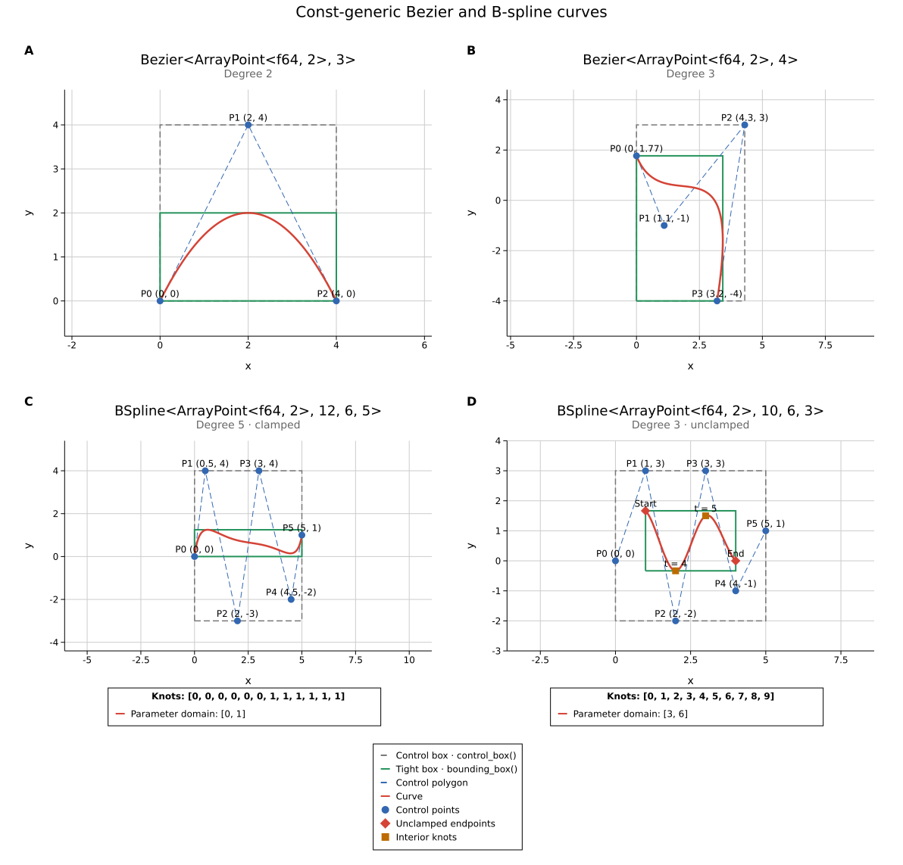

# stroke  


A zero-allocation library providing const-generic implementations of Bézier curves, B-Spline curves and specialized implementations of up to cubic Bézier curves in N-dimensional euclidean space. It is intended for general/embedded/wasm use supporting #![no_std] environments written in 100% safe Rust with minimal dependencies.



Made with [Kuva](https://github.com/Psy-Fer/kuva). Regenerate with `cargo run --example kuva_curves`.

The library makes heavy use of const-generics and `generic_const_exprs`, so the nightly compiler is required.  
This repo uses `nightly` via `rust-toolchain`.  
Consumers using const-expression-based APIs (such as bounding boxes) must also
enable `#![feature(generic_const_exprs)]` at their crate root on nightly.
It comes with a const-generic N-dimensional Point type so you can use the library without any other dependencies.  
`PointN<T, N>` uses your chosen scalar `T` (typically `f32`/`f64`) and keeps the dimension at compile time.  
Point scalar types must implement `num_traits::Float`; the library therefore currently targets floating-point numeric representations such as `f32` and `f64`.

Should you want to integrate with types provided by another library, implement the small `Point` trait. Optional extension traits (`PointIndex`, `PointDot`, `PointNorm`) unlock component access and geometric helpers when needed.  

Right now, the generic versions don't implement all methods that the specialized versions do (as the algorithms get a bit more complicated) but should reach parity eventually.

## Integration features

- `nalgebra`: implements `Point` for `nalgebra::SVector<T, D>` (no_std + libm).
  Requires `T: nalgebra::RealField + num_traits::Float` (typically `f32` or `f64`).

Example:

```rust
use nalgebra::SVector;
use stroke::Bezier;

let curve = Bezier::<SVector<f32, 2>, 3>::new([
    SVector::<f32, 2>::new(0.0, 0.0),
    SVector::<f32, 2>::new(1.0, 0.0),
    SVector::<f32, 2>::new(1.0, 1.0),
]).unwrap();

let mid = curve.eval(0.5);
```

Enable with:

```toml
stroke = { version = "0.4", features = ["nalgebra"] }
nalgebra = { version = "0.34", default-features = false, features = ["libm"] }
```

## Goals

- Provide generic Bézier curves and B-Splines. Due to their frequent usage, further provide lines, quadratic and cubic Bézier curves
- Support no-std for all targets
- Extensive unit testing and code coverage
- Integration tests for other generic math libraries (TBD - maybe optimath, aljabar, micromath, nalgebra) since Point types are replicated in many libraries

## Non-Goals

- Focus on use for rendering or highest performance (no GPU)

## Features

These are the main supported features. Some further utility methods are exposed where useful.  

### Quadratic and Cubic Bézier Curves

- [x] evaluation (De Casteljau, direct)
- [x] split
- [x] derivative
- [x] tangent (unit)
- [x] normal (principal)
- [x] curvature (magnitude)
- [x] arc length (linear approx.)
- [x] arc length (adaptive Gauss-Legendre)
- [ ] Frenet-Serret frame / torsion
- [x] bounding box
- [x] tight axis-aligned bounding box and conservative control-point bounds

### Generic Bézier Curves

- [x] evaluation (De Casteljau)
- [x] split
- [x] derivative
- [x] tangent (unit)
- [x] normal (principal)
- [x] curvature (magnitude)
- [x] arc length (linear approx.)
- [x] arc length (adaptive Gauss-Legendre)
- [ ] Frenet-Serret frame / torsion
- [x] bounding box
- [x] tight axis-aligned bounding box and conservative control-point bounds

### Generic B-Splines

- [x] evaluation (De Boor)
- [x] Bézier span extraction (`bezier_spans`, without allocation)
- [x] derivative
- [x] basis functions (and derivatives)
- [x] tangent (unit)
- [x] normal (principal)
- [x] curvature (magnitude)
- [x] arc length (polyline approximation)
- [x] arc length (adaptive Gauss-Legendre)
- [ ] Frenet-Serret frame / torsion
- [x] bounding box
- [x] tight axis-aligned bounding box and conservative control-point bounds

### Arc length and bounds

Every curve, segment, and path provides `arclen(accuracy)`,
`arclen_between(start, end, accuracy)`, `t_at_length(length, accuracy)`, and
`point_at_length(length, accuracy)`. Length calculations use adaptive 8/16-point
Gauss-Legendre quadrature, with explicit splits at stationary-point candidates
and B-spline knots. Lines use their exact Euclidean length.

`accuracy` is a finite, positive absolute length tolerance, subject to scalar
roundoff. The quadrature error estimate controls subdivision; it is not an
interval-arithmetic proof of the error. These methods return `Result`, reporting
invalid inputs, non-finite arithmetic, or exhausted convergence budgets.
`arclen_polyline(segments)` retains the cheaper sampling approximation, with a
subdivision count per curve (per nonzero knot span for B-splines).

Inverse lengths clamp finite distances to the endpoints and choose the start
for zero-length curves. Paths return `Result<Option<_>, ArcLengthError>` for
inverse length and point lookup: `Ok(None)` means the path is empty. Empty paths
have length zero. Disconnected segments and full-multiplicity spline knots
contribute the lengths of their pieces without an implicit connecting line;
lookup at an interior boundary selects the piece on its right. Path parameters
remain uniformly partitioned by segment; B-spline parameters use the standard
active knot domain `[knots[D], knots[C]]`.
Path evaluation and inverse-length lookup share the same representable segment
boundaries. Point lookup retains the selected segment directly, avoiding loss
of local precision through a normalized parameter round trip.

`bounding_box()` returns a tight `BoundingBox<Scalar, DIM>`, with analytic extrema
for quadratic/cubic curves and Bernstein convex-hull subdivision for generic
Béziers and extracted B-spline spans. Tightness is subject to floating-point
resolution. Generic bounds refine in local coordinates so a large translation
does not inflate the stopping tolerance; the final bounds still round to the
chosen scalar's coordinate precision. `control_box()` returns the axis-aligned box around the control
points. Ordinary Bézier and B-spline curves lie inside their control-point convex
hull, so these control bounds also enclose the curve, but are usually looser.
The box supports `axis`, indexing, `contains`, `union`, and `into_axes`. Path
boxes are `None` when empty.

For example:

```rust
use stroke::{Bezier, PointN};

let curve = Bezier::new([
    PointN::new([0.0_f64, 0.0]),
    PointN::new([1.0, 2.0]),
    PointN::new([2.0, 0.0]),
]).unwrap();
let length = curve.arclen(1e-10).unwrap();
let midpoint = curve.point_at_length(length * 0.5, 1e-10).unwrap();
let tight = curve.bounding_box();
let control = curve.control_box();
assert!(tight[1].1 < control[1].1);
```

`distance_to_point*` still uses sampling-based approximations; increase its step
count for accuracy. General B-spline splitting into two fixed-size B-spline
values is not currently provided; use `bezier_spans()` for decomposition.

### Convenience APIs

- `PointN` converts to/from arrays, exposes `as_array()`/`into_array()`, and supports borrowed iteration.
- Curves expose borrowed `control_points()` iterators and owned `into_control_points()` arrays. Use `set_control_points()` for atomic validated replacement or `try_map_control_points()` for validated mapping; mapping controls represents a geometric transform only for affine maps. Generic Bézier controls no longer support mutable iteration.
- Lines, quadratic/cubic Béziers, and equivalent generic Béziers convert losslessly with `From`/`Into`.
- `BSpline::new_clamped_uniform(points)` builds a fully clamped uniform knot vector on `[0, 1]`; it shapes a curve from controls, not an interpolant through every control point.
- `derivative_at(t)` and `speed(t)` avoid constructing derivative curves. They are measured per unit of the curve's parameter: native knot units for B-splines, normalized path units for paths. At interior boundaries they use the right-hand piece, at the final endpoint the left; no differentiability across a jump is implied.
- Bézier curves and segments provide checked `subcurve(start..end)`, reparameterized to `[0, 1]`, and `split_at_length(length, accuracy)`. Equal subcurve endpoints produce a constant curve; invalid ranges are rejected.
- Paths provide `try_push()` (returning the segment on overflow), `capacity()`, `remaining_capacity()`, `pop()`, and `clear()` for reusable fixed-capacity storage. Existing boolean `push` methods remain available.
- Boxes expose `min()`, `max()`, `center()`, `extent()`, `intersects()`, and `intersection()`. Touching boundaries count as intersection; box overlap alone does not prove curve intersection. Finite bounds can have an overflowing extent.

For migration from 0.3: constructors are fallible; replace sampling-based
`arclen(steps)` with `arclen_polyline(steps)` or accuracy-controlled `arclen(accuracy)?`.
Inverse-length methods now take an accuracy target and return `Result`; boxes
use `into_axes()` for raw arrays. For copied controls use `into_control_points()`
or `control_points().copied()`, and use checked replacement instead of mutable
Bézier iteration. Error types implement `core::error::Error` and are exported at
the crate root.

## Examples

- `bezier_path`: mixed Bezier path segments; run `cargo run --example bezier_path`.
- `bspline_path`: basic B-spline path evaluation; run `cargo run --example bspline_path`.
- `bspline_signal_1d`: 1D signal interpolation with a cubic B-spline; run `cargo run --example bspline_signal_1d`.
- `bezier_quarter_circle`: cubic Bezier quarter-circle approximation; run `cargo run --example bezier_quarter_circle`.
- `arc_length_sampling`: equal-arc-length sampling along a Bezier curve; run `cargo run --example arc_length_sampling`.
- `motion_3d`: constant-path-speed sampling of a 3D robot/tool trajectory, producing CSV positions and velocities; this is not an acceleration-limited motion planner. Run `cargo run --example motion_3d`.
- `spatial_queries`: CAD/GIS broad-phase filtering with tight versus control boxes, overlap queries, and trimmed curve bounds. Run `cargo run --example spatial_queries`.
- `animation_envelope`: scalar B-spline value and rate over a native time domain, producing CSV output. Run `cargo run --example animation_envelope`.
- `tangent_normal_curvature`: sample tangent/normal/curvature; run `cargo run --example tangent_normal_curvature`.
- `kuva_curves`: render a 2×2 SVG figure with generic quadratic and cubic `Bezier` curves, a clamped quintic `BSpline`, and an unclamped cubic `BSpline`, with curve bounding boxes, control polygons, named control points, knot-vector legends, and marked interior knots and unclamped endpoints; run `cargo run --example kuva_curves` to write `curves.svg`. Uses Kuva's SVG backend with optional features disabled; no system font library or font installation is required.
- `nalgebra_basic`: Bezier with nalgebra SVector; run `cargo run --example nalgebra_basic --features nalgebra`.
  
## Development

Install the nightly tools once with `rustup component add rustfmt clippy`.
Run `cargo lint` for all targets with all features, or `cargo lint-default`
for all targets without default features. Both treat warnings as errors;
CI runs both commands. `.cargo/config.toml` also selects the compatible
nightly trait solver for local builds, Clippy, and doctests.
Run `cargo test --examples --all-features` for example assertions. CI also
builds a separate downstream consumer from outside the repository, without
inheriting this configuration. The API pass was tested with
`rustc 1.101.0-nightly (7df81381d 2026-10-14)`; stable Rust is not supported.

Enable automatic checks before each commit in a fresh clone:

```sh
git config --local core.hooksPath .githooks
```

The hook checks formatting and runs both lint commands. It requires no extra
hook manager. To disable it, run `git config --local --unset core.hooksPath`.

Lint levels are in `Cargo.toml`, with lint options in `clippy.toml`.
The policy keeps Clippy's default checks, adds Cargo metadata checks,
portable `core`/`alloc` API checks, documentation formatting, redundant-clone
checks, and checks for debug macros, unfinished code, and process exits.
Unsafe code is forbidden for every target. Clippy reads the declared MSRV
from `package.rust-version` and checks test code against it as well.

We enable extra lints individually rather than enabling all of `pedantic`,
`nursery`, or `restriction`. Exact floating-point knot comparisons, indexed
arrays, scalar casts, and short mathematical variable names are intentional
in these algorithms. Unwraps are also intentional for scalar conversions
and test assertions; they are not banned globally. Any lint exception should
be scoped to the relevant item and explain why it applies.

## Related  

If you're looking for a published crate for rendering with gpu support you should check out [Lyon](https://github.com/nical/lyon) from which I draw some inspiration, it's really good. It features lines, quadratic and cubic Béziers, in addition to arcs, triangles, and other geometric objects but no general Bézier curves or B-Splines. It also does seem to support wasm.  

Also, there's [Twinklebear/bspline](https://github.com/Twinklebear/bspline) which is a very clean and useful library for just bsplines. However, it depends on std and its simple Interpolate trait defines no way to access the individual dimensions of the points and hence implements no derivatives in the library.  

This clear online book [A Primer on Bézier Curves](https://pomax.github.io/bezierinfo/) helped me with a lot of the algorithms involved.
